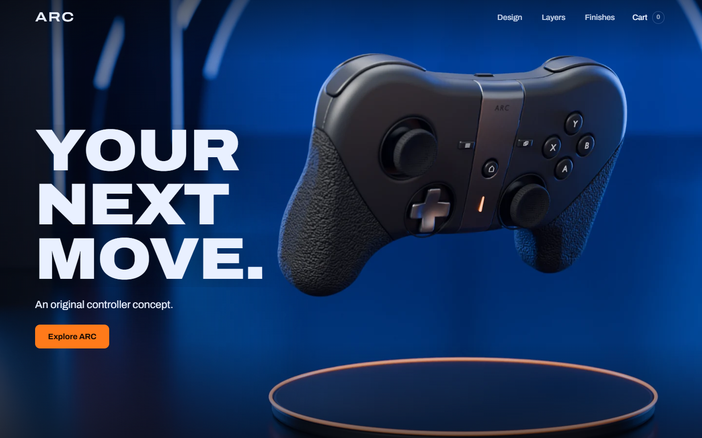
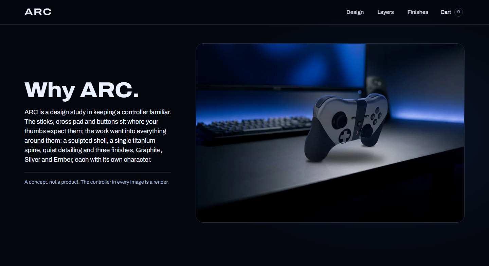
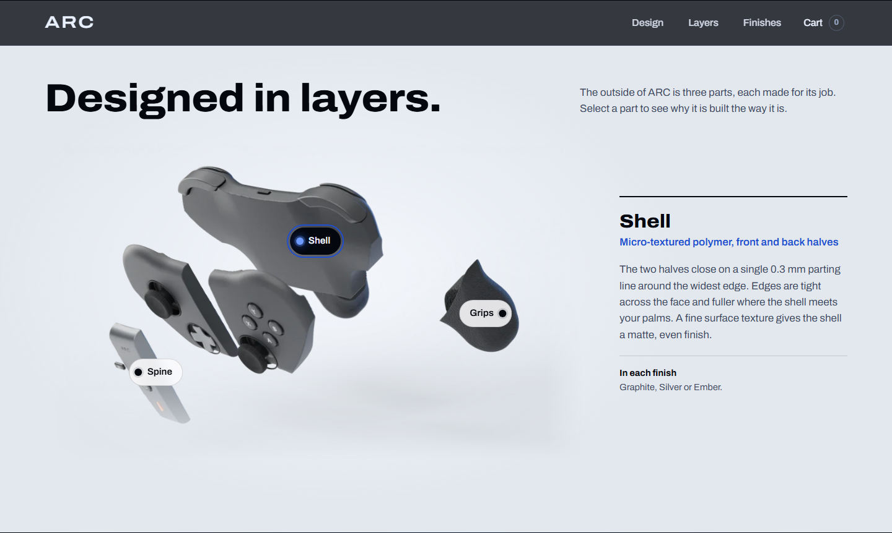
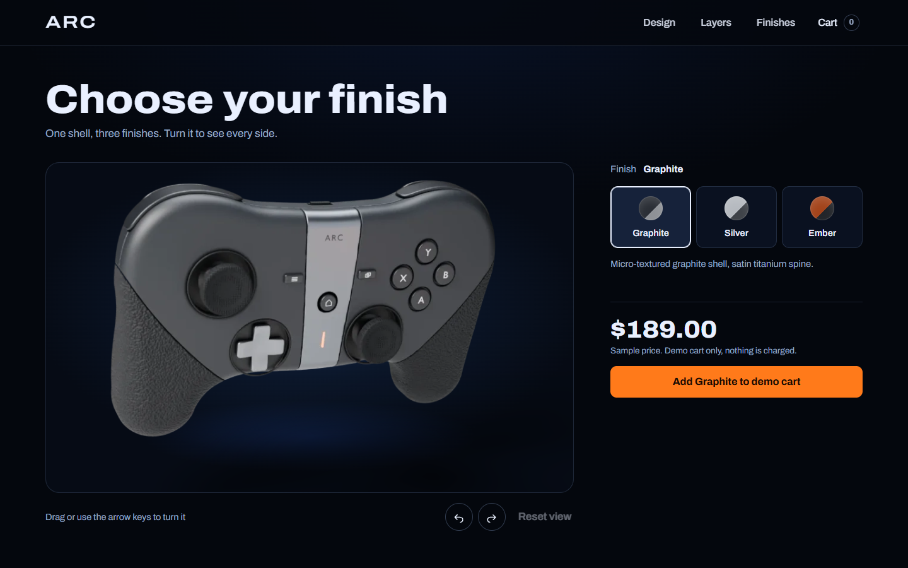

# ARC controller concept

A one-page launch site for **ARC**, a fictional gaming controller made for a portfolio. The opening is a cinematic
camera move through an arched hall, scrubbed by the scroll: the whole product, a stick macro, the control face and the
rear shoulders. Then "Why ARC", the design intention beside a gaming-setup image; "Designed in layers", an exploded
view of the exterior parts with three callouts; and a finish configurator with a 360° turntable and a demo cart. ARC
is not a real product and the cart never charges anything. The footer carries that disclosure, links to each section
and a short credit; how the site was built is documented here, for the case study.

Stack: React 19, Vite, TypeScript, GSAP with ScrollTrigger, Lenis. The product and scene are modelled and rendered
offline in Blender 5.2 (Cycles, GPU); the page displays those renders without requiring WebGL. Playback smoothness
depends on the browser, device, image decoding and loading conditions.



| Why ARC | Designed in layers | Finishes |
| --- | --- | --- |
|  |  |  |

Design references: `design/arc-v2/`. The working briefs are kept out of the repository (see `.gitignore`).

## Run it

```powershell
npm install
npm run dev        # http://localhost:5173
npm run build      # type-check + production build into dist/
npm run preview    # serve the production build on http://localhost:4173
```

Add `?static` to the URL to see the plain-image fallback (no canvases). With the OS "reduce motion" setting on, the
journey becomes four still compositions and the turntable jumps instead of easing.

## Where to edit

| What | File |
| --- | --- |
| Product name, sample price, finishes, chapter copy, layer callout copy, Why ARC copy, footer credit | `src/data/product.ts` |
| Opening copy and the scroll journey (frame drawing) | `src/components/Showcase.tsx` |
| "Why ARC" section (lazy setup image) | `src/components/Why.tsx` |
| Setup image (composite of the backdrop and an ARC render) | `design/why-arc/compose_why.py` → `public/why/` |
| Footer links, disclosure and credit | `src/components/Details.tsx` |
| Journey frame plan (frame count and spacing) | `design/arc-v4/plan_journey.py` → `src/data/journeyFrames.json` |
| "Designed in layers" section (callouts, lazy render) | `src/components/Layers.tsx` |
| Exploded render and callout positions | `design/arc-v4/render_layers.py` → `src/data/layersAnchors.json`, `design/arc-v4/encode_layers.py` |
| Configurator (turntable, keyboard controls, finish picker) | `src/components/Configurator.tsx` |
| Frame counts and paths of the rendered media | `src/media.ts` |
| Cart logic and local storage | `src/hooks/useCart.ts`, `src/components/CartDrawer.tsx` |
| Colours, type scale, layout | `src/styles.css` (tokens at the top) |
| Controller model (Blender) | `design/arc-v4/build_arc.py` → `design/arc-v4/arc.blend` |
| Scene, camera shots, lights, render jobs | `design/arc-v4/render_scene.py`, `design/arc-v4/render_lib.py` |
| Web GLB export | `design/arc-v4/export_glb.py` → `design/arc-v4/arc.glb` |

## The model

`build_arc.py` builds ARC in Blender. Every moulded part is a signed distance field built from constructive
operations: smooth unions for the body, rounded intersections for controlled edge radii (a crisp face edge and a
defined shoulder top, fuller radii on the grips), and subtractions for the stick and button wells, the port, the bumper
pockets and the trigger finger scoops. The front shell, back shell, rubber grips, titanium spine, bumpers and triggers
are separate parts with real ~0.3 mm parting gaps. Fields are sampled at 0.36 mm (0.12-0.15 mm for small controls) and
meshed with OpenVDB. Legends and wordmarks are real text geometry. Materials are grouped (shell, grip, spine, plastic,
rubber, metal, buttons, liner, legend, engrave, accent), so finishes swap coherently; procedural bump gives the polymer
micro-texture, pebbled grips, brushed spine and dimpled stick caps. Raw units are 12 mm; the root converts to metres.

`export_glb.py` writes a decimated, Draco-compressed GLB (about 238k faces, 0.7 MB) with the same material groups,
for any future live 3D use. The website itself does not load it.

## Renders

`render_scene.py` (run with Blender in the background) renders everything the page uses:

```powershell
$b = "C:\Program Files\Blender Foundation\Blender 5.2\blender.exe"
& $b --background --factory-startup --python design\arc-v4\build_arc.py
& $b --background --factory-startup --python design\arc-v4\render_scene.py -- keys both      # review stills
& $b --background --factory-startup --python design\arc-v4\render_scene.py -- sequence both  # public/journey/
& $b --background --factory-startup --python design\arc-v4\render_scene.py -- turntable      # public/spin/
& $b --background --factory-startup --python design\arc-v4\render_scene.py -- thumbs         # public/renders/
```

- **Journey:** 193 frames per device through four chapter keyframes (desktop keys 0, 71, 139, 192; phone 0, 85,
  134, 192). `plan_journey.py` spaces the frames so that each step changes the picture by about the same amount
  (measured from an earlier render), instead of a fixed number of eased frames per chapter: the busiest moves get
  the most frames. The plan is `src/data/journeyFrames.json` (frame positions along the camera move, and the key
  frames); `render_scene.py -- sequence both` reads it, renders coarse to fine (chapter frames first), denoises with
  OIDN and writes lossless PNG masters to `work/journey-v2/<device>/`. An interrupted run resumes with the missing
  frames. `encode_journey.py -- <dst> 88` encodes the masters into the shipped WEBP sets; encode into a work folder,
  check it, then copy into `public/journey/`:
  - `desktop`: 1920×1200, 13.8 MB;
  - `desktop-s`: 1440×900 from the same masters, 9.4 MB;
  - `phone`: 828×1794, 11.3 MB.

  The page picks the smallest set that is not enlarged by more than 10% (`JOURNEY_SETS` / `pickJourneySet` in
  `src/media.ts`), so ordinary desktop windows get 1440 and large or high-density screens 1920. Shots are defined in
  `DESKTOP` / `PHONE` at the top of `render_scene.py` (product yaw/tilt, camera orbit, lens, lens shift, focus,
  aperture, light levels). The previous 145-frame set is kept in `work/journey-prev/`.
- **Turntables:** 96 frames per finish (3.75° apart) on a transparent stage with a shadow catcher, in two sizes made
  from the same 1440×1080 renders (`work/spin-hd/<finish>/`) with `reencode.py`:
  - `public/spin/<finish>`: 1200×900 WEBP 85, about 8.3–8.7 MB per finish (`-- <src> <dst> 85 "*.webp" 1200`);
  - `public/spin-s/<finish>`: 960×720 WEBP 85, about 6 MB per finish (`... 960`).

  The viewer uses the smaller set unless it would be enlarged by more than 10% (`TURN_SETS` / `pickTurnSet` in
  `src/media.ts`), so phones and ordinary desktop screens get 960 and high-density desktops 1200. The cobalt rims
  are off for the turntable so each finish shows its true colour from every side. The product is sized from
  `TURN_SAFE`, its measured outline over all frames (`work/turn_bounds.py`). The viewer blends neighbouring frames
  while turning and settles on a single frame when released. The selected finish loads every frame (the current
  angle first, then coarse to fine); the others preload every fourth.
- **Thumbnails:** `public/renders/thumb-<finish>.png` for the cart.
- **Designed in layers:** `render_layers.py -- final layers` moves the real parts of `arc.blend` apart along the
  controller's depth axis (titanium spine with its centre keys; front shell with sticks, cross pad and buttons; back
  shell with bumpers, triggers and port; rubber grips), on a light studio with a transparent film and shadow catcher,
  2400×1500. It also projects a surface point on the spine, back shell and right grip to `src/data/layersAnchors.json`,
  which places the callouts. `encode_layers.py` writes `public/layers/exploded-{2400,1600,1000}.webp` (304 / 139 /
  64 KB). The page loads the render about one screen before the section (its own observer: the browser's lazy
  loading starts while the reader is still in the journey). The callouts are a tab list: pointer, touch, and
  arrow keys / Home / End.
- **Why ARC setup image:** the desk backdrop was generated with ForgeGUI's cloud image generation (no controller in
  it; prompt and job in `design/why-arc/PROMPT.txt`). The controller is this project's own render, the Silver
  turntable frame 06 (`design/why-arc/source/`). `compose_why.py` cuts the controller from its transparent render,
  tones it for the dark room, adds a cobalt rim from the light strip, contact shadows and grain, and writes
  `public/why/setup-{1800,1200}.webp` (3:2, 43 / 20 KB) and `setup-p-{1000,640}.webp` (4:5 for phones, 31 / 14 KB).
  It runs in headless Chromium's software canvas, not on the GPU. The section loads the image about one screen
  before it arrives (`useNear`), and phones get the 4:5 crop below the text.
- **Scene:** a satin floor, a low thin platform, receding arches with light strips housed in channels, overhead beams,
  side pillars with light slots, foreground framing forms, a backlit far wall, thin volumetric haze and cobalt beams.
  The product has its own neutral key, cobalt rims and a small warm kicker that turn with the camera.

On this machine (RTX 3070 Laptop, OptiX) a desktop journey frame takes about 20 s, a turntable frame a few seconds.

The page fetches the opening frame first, alone, then the chapter keyframes and a coarse pass (every 24th, 12th and 6th
frame), then the rest nearest to the reader's position first, four requests at a time, and keeps each as its compressed
file. If the opening frame fails, its neighbour is shown and the opening frame is retried. Frames are decoded off the
main thread (`createImageBitmap` from a Blob), already cropped and scaled to the canvas (never larger than the file),
for a window around the current position (14 frames ahead and 6 behind in the direction of travel on desktop, 11 and
5 at phone size) plus anchors every 24th frame, so a draw is a plain copy. Up to six decodes run at once, the frames
just ahead first. While the journey is off screen it keeps only the frames at its current position and stops
fetching.

**Decoded-frame budgets.** Each canvas publishes its count (`data-decoded`, `data-budget`) for the checks:
- journey: 30 frames on desktop, 26 at phone size;
- turntable: 36 on desktop, 24 at phone size (`CACHE` in `Configurator.tsx`). These cover the frames being drawn, a
  ring around the angle (longer ahead), the angle a turn is heading for, anchors, and one frame per other finish.
  Everything else is released.

Before/after measurements: `qa/perf/PERFORMANCE-REPORT.md`. The drawn position is fractional: while scrolling, each pair of neighbouring frames is
cross-blended (they differ by a few pixels), and when the scroll settles the view eases onto the nearest single frame,
so it always rests sharp. `journeyPosition` in `Showcase.tsx` keeps half of the rendered ease at each chapter, so the
camera slows for reading but never stops dead while the page moves.

Wheel, keyboard and in-page link scrolling are smoothed by Lenis (`src/smoothScroll.ts`), driven by the GSAP ticker so
ScrollTrigger and the page text share one interpolated scroll position. Touch scrolling stays native; reduced motion
and `?static` keep native scrolling throughout. Turntables start loading only when the configurator is within 400 px
of the viewport, with no placeholder image, so nothing competes with the opening screen. The selected finish takes
priority, and switching finishes preserves and resumes partially loaded turns.

### Performance evidence

All figures come from headless Chromium on this laptop (software canvas, no GPU), so they compare builds with each
other; they do not predict a particular phone or browser. Physical-phone testing remains outstanding.

- **Frames.** `work/journey_ghost.py` compares neighbouring frames (mean absolute pixel difference, 0–255) and the
  error of the cross-fade the page shows between two frames:

  | | largest step between frames | worst cross-fade error |
  | --- | --- | --- |
  | desktop, 145 frames (before) | 11.2 | 8.0 |
  | desktop, 193 planned frames | 6.6 | 4.4 |
  | phone, 145 frames (before) | 18.5 | 15.1 |
  | phone, 193 planned frames | 8.4 | 5.9 |

  The new set has no large jumps between neighbouring frames, so the in-between blends no longer show doubled
  edges.
- **Scrolling** (`scripts/perf_journey.py`, steady and fast scrolls through the journey). At 1440×900 the new build
  shows the needed frames throughout: fast scrolling went from 76 of 107 animation frames showing a neighbour
  frame to none, and from 13 slow (over 25 ms) animation frames to none. At 1920×1080 and at phone size, decoding
  more frames per scroll distance costs more: fast phone-size scrolling shows a neighbouring frame in many
  animation frames (the frames are close together, so the jump is small) and has about 20–30 slow animation frames
  out of 175, against roughly 2–13 for the old build. Unlimited parallel decoding, a symmetric window, a cap of 10
  and skipping the resize were all tried and did not do better overall. Details: `qa/perf/PERFORMANCE-REPORT.md`.

## QA scripts

- `scripts/qa_interactions.py [url]`: functional checks for the opening, chapter navigation, the rail, finish selection
  (pointer and keyboard), turntable drag/touch/keys (including rapid presses), reset, cart quantities and thumbnails,
  persistence, focus handling, the phone first screen, reduced motion, the `?static` fallback and console errors.
- `scripts/qa_screens.py [url] [tag]`: desktop (1440×900) and phone (390×844) screenshots of every chapter, the
  configurator and each finish, saved to `qa/screenshots/<tag>/`.
- `scripts/qa_turntable_loading.py [url]`: focused checks for deferred loading, rapid finish changes with delayed
  images, complete turntables, rotation and exact default-image restoration after a cancelled touch gesture.
  Run against the dev server to include React StrictMode's setup replay.
- `scripts/qa_cache.py [url]`: decoded-frame budgets and release (journey and turntable) through scrolling, flicks,
  wrapping angles, finish switches and resize; a blocked opening frame and a blocked turntable frame; deep links (`/#configure`). Also run it
  against the dev server.
- `scripts/perf_report.py [url] [label] [scenarios]`: transfer, time to the opening, journey and usable
  turntable, finish changes, process memory and drag smoothness for desktop, throttled phone size and warm phone
  size, written to `qa/perf/<label>.json`. `scripts/perf_summary.py before after` compares two runs.
- `scripts/qa_visual_compare.py <before_url> <after_url>`: viewer screenshots at website size, with PSNR.
- `scripts/qa_layers.py [url] [tag]`: the layers section on desktop, phone size, tablet and reduced motion: lazy
  loading, callouts on their anchors, 44 px targets, tab semantics and keys, contrast, overflow, the footer
  disclosure, the nav link and `/#layers`, `?static`, and that the configurator and cart still work.
- `scripts/qa_why.py [url] [tag]`: Why ARC and the footer on desktop, phone size and reduced motion: lazy loading,
  the right crop per screen, image beside or below the text, word count, every footer link reaching its section,
  44 px targets, the disclosure and credit, `/#why`, Back after a footer link, and `?static`.
- `scripts/perf_journey.py <url> <label> [WxH]`: journey smoothness while scrolling (draws that had to show a
  neighbouring frame because the needed ones were not decoded yet, position change per animation frame, pacing).
- `work/journey_ghost.py <folder>`: how different neighbouring journey frames are, and the error of cross-fading
  across a missing frame.
- `design/arc-v4/render_studio.py -- [tag] [finish]`: the bare model on a neutral grey studio backdrop (three-quarter,
  front, rear, side, top, stick close-up), for judging shape and surfaces.

## Design notes

- **Palette:** chamber black `#04070d`, navy `#0a1426`, cobalt `#2e6cff` (light only), ice white `#e9f0ff` for type,
  haze `#9aabc8` for secondary text, amber `#ff7a1a` for the primary action and the status slit.
- **Type:** Archivo throughout: expanded black for the opening line, expanded bold for titles, regular for body.
- **Model and scene:** original, built procedurally in Blender; no third-party models. The downloaded candidates that
  were reviewed and not used are excluded from the repository.
- **Generated imagery:** the desk backdrop of the setup image (ForgeGUI) and the early concept references in
  `design/arc-v2/` were made with image generation; their prompts are kept alongside them. The footer credit says so.
- **Copy:** the page describes what the renders show and what the design intends. It makes no performance claims
  (battery, latency, grip, durability, fingerprints), because ARC has never been built or tested.

## Publishing

`npm run build` writes a static site to `dist/`; any static host can serve it. Media paths are absolute (`/journey/`,
`/spin/`, `/why/` …), so serve the site from the root of a domain or subdomain (for example Netlify, Vercel or
Cloudflare Pages). A GitHub Pages project site lives under `/<repository>/` and would need a `base` setting in
`vite.config.ts` plus base-relative media paths first.

**Netlify (set up):** Add new site → Import an existing project → GitHub → this repository. `netlify.toml` supplies
the build command (`npm run build`), the publish folder (`dist`) and Node 24, so the defaults can be accepted. Every
push to `main` redeploys. **Cloudflare Pages** also works: framework preset Vite, build command `npm run build`, output
folder `dist`.

`public/_headers` (read by both hosts) caches the hashed files in `/assets/` for a year and the rendered media for a
week, and sends basic security headers. The build is about 1,170 files and 78 MB, with no file over 0.4 MB.

**No secrets:** the site is static and uses no API keys or environment variables, so none should be added on the
host. Anything placed in a `VITE_` variable is bundled into the public JavaScript. `.env` files, key files and host
CLI folders are ignored by Git. The repository, its history and the built output were scanned for keys and tokens
before publishing; none were found.

Once the site has its address, add `og:url` and an absolute `og:image` (for example a 1200×630 render) to
`index.html` for link previews.

What the repository leaves out (`.gitignore`): `node_modules`, `dist`, the render masters and experiments in `work/`
(about 1.3 GB, regenerated by the Blender scripts), check screenshots and logs, Blender backup files, the
unused third-party candidates and the working briefs. The shipped media in `public/` is about 80 MB in many small
files and `design/arc-v4/arc.blend` is 28 MB, all within GitHub's per-file limit, so Git LFS is not needed.

## Licence

The code is MIT-licensed. The ARC design, model, renders, frames and screenshots are all rights reserved: you can
view them here and on the site, but not reuse them without permission. The generated desk backdrop in the setup
image is subject to ForgeGUI's terms. See [LICENSE](LICENSE) for exactly which files fall under which terms.
